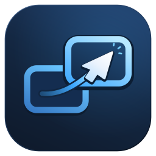

<p align="center"></p>

<h1 align="center">Curslink</h1>

**Look at a device, and your mouse and keyboard follow.**

Curslink lets one keyboard and mouse drive all your computers. A webcam
notices which screen you're looking at and sends your pointer and typing
there. Or push the pointer off the edge of one screen and it pops out on the
next computer, with a quick "pop" or "blink" so you always see where it went.

[**Download the latest release**](https://github.com/kylepantall/Curslink/releases/latest) ·
[How it works](#how-it-works) · [Getting started](#getting-started) ·
[FAQ](#faq)

## Why Curslink

* **Look to switch.** Glance at your laptop and your keyboard and mouse are
  on your laptop. No hotkeys, no reaching for a KVM switch.
* **Or slide across.** Arrange your screens like your desk and move the
  pointer between computers as if they were one big display.
* **Any mouse, any keyboard.** Your Bluetooth or USB devices stay connected
  to one computer; Curslink forwards their input over your network in
  milliseconds, instead of slowly re-pairing.
* **Pair with a code.** Devices find each other on your network. Type a
  6-digit code once and they're linked, with their own encryption key.
* **Works across the internet too**, through a small relay you host yourself.
* **Windows, macOS and Linux.** Android is on the roadmap.
* **Keeps itself up to date**, with every download checked before it installs.

> Curslink is young (0.x). It works day to day, but expect rough edges, and
> please [open an issue](https://github.com/kylepantall/Curslink/issues)
> when you hit one.

## How it works

```
 ┌──────────── host (keyboard + mouse + webcam) ────────────┐        ┌──── agent ────┐
 │ webcam → head pose → gaze classifier ┐                   │  TLS   │               │
 │                                      ├→ router ──────────┼───────→│ inject input  │
 │ keyboard/mouse capture ──────────────┘   (who's active?) │  LAN   │ + animation   │
 └──────────────────────────────────────────────────────────┘        └───────────────┘
```

* The **host** is the computer your keyboard, mouse and webcam are plugged
  into. It captures your input and, while you're using another computer,
  sends it there instead.
* Every other computer runs an **agent**, which plays back what it receives
  and shows the switch animation.
* The webcam only estimates which way your head is turned, on the host
  itself. No video leaves your computer.

## Getting started

### 1. Install it on every computer

| Platform | Download | What it does |
| --- | --- | --- |
| Windows 10/11 | `curslink-X.Y.Z-windows-x64-setup.exe` | Installs for your user (no admin needed) and adds `curslink` to your PATH |
| macOS (Apple silicon) | `curslink-X.Y.Z-macos-arm64.pkg` | Installs `curslink` to `/usr/local/bin` |
| Debian / Ubuntu | `curslink-X.Y.Z-linux-x64.deb` | `sudo apt install ./curslink-*.deb` |

Get them from the [latest release](https://github.com/kylepantall/Curslink/releases/latest).
They include everything, so you don't need Python. Portable `.zip` and
`.tar.gz` builds are there too if you'd rather not install.

The installers aren't code-signed yet. On Windows, click **More info**, then
**Run anyway**. On macOS, right-click the `.pkg` and choose **Open**.

### 2. Set it up

1. Copy [`examples/curslink.toml`](examples/curslink.toml) to each device and
   edit it: describe every device's screens in one shared layout (arranged
   like your desk) on the host, and set `[agent]` `device_id` and `name` on
   agents.
2. Check the layout on the host: `curslink check`
3. Start agents: `curslink agent` (on each other device)
4. Pair them: run `curslink pair` on the host, pick a device from the list,
   and type the 6-digit code it shows into the window that pops up on that
   device. No secrets to copy, and agents find the host on the network by
   themselves. Add `--as host` if the config also has an `[agent]` table,
   like the example. (You can also run `curslink pair` on an agent while
   the host is running.)
5. Teach it where your screens are: `curslink calibrate` (on the host;
   look at each screen when asked)
6. Run the host: `curslink host`

`curslink pair --list` shows what a device is paired with and
`curslink unpair ID` forgets one. If your network blocks multicast,
`curslink pair --address 192.168.1.20` pairs with a device directly.

### Over the internet (self-hosted relay)

When the devices aren't on the same network, run a relay somewhere they
can all reach, for example a small VPS with a DNS name. The relay only
matches devices up and forwards encrypted bytes; it never sees your
pairing secret, so it can't read or inject keystrokes.

1. On the server: `curslink relay --init` writes `relay.toml` with a random
   relay key. Open TCP port 24852, then run `curslink relay -c relay.toml`
   (see [`examples/relay.toml`](examples/relay.toml)).
2. Make a pairing code:
   `curslink invite --relay relay.example.com:24852 --relay-key <key>`
3. Put the code in `curslink.toml` on the host **and** every agent, in place
   of `secret`:
   ```toml
   [relay]
   code = "curslink1-..."
   ```
   (or set `CURSLINK_PAIRING_CODE`). `[relay] address` and `key` with a
   normal `secret` work too.
4. Start `curslink host` and `curslink agent` as usual. Agents can drop
   `[agent].host`; if they keep it they try the LAN first and fall back to
   the relay. Set `[host] lan = false` to only accept agents via the relay.

Devices you've already paired with `curslink pair` don't need a pairing
code: give them just `[relay] address` and `key`. Each paired agent then
meets the host in its own relay room, derived from that pair's key, and a
laptop paired at home keeps working through the relay when it's away.

Hotkeys on the host:

| Keys | Action |
| --- | --- |
| `Ctrl+Alt+Home` | Bring input back to the host, always |
| `Ctrl+Alt+G` | Pause / resume gaze switching |

Try the animations with `curslink overlay-test --effect pop`.

### Install from source

Prefer Python? With Python 3.13+:

```bash
pip install "curslink @ git+https://github.com/kylepantall/Curslink"          # every device
pip install "curslink[gaze] @ git+https://github.com/kylepantall/Curslink"    # host, for the camera
```

### Updates

Installed copies keep themselves up to date. When `curslink host` or
`curslink agent` starts, it checks for a newer release, downloads the
installer for your platform, checks it against the release's
`SHA256SUMS.txt`, installs it and carries on with the new version. macOS and
Linux ask for your password; Windows updates silently. While it runs, it
checks once a day and installs what it finds at the next start.

* `curslink update` updates right now (`--check` only looks, `--pre`
  includes release candidates).
* To turn it down or off, set `CURSLINK_NO_UPDATE=1` or add this to
  `curslink.toml`:

  ```toml
  [update]
  check = true        # look for new releases
  auto = true         # install them at startup (false: just tell me)
  prerelease = false
  ```

## FAQ

**Does the camera record me?** No. Frames are processed in memory on the
host to estimate head angle, then thrown away. Nothing is saved or sent.

**Do I need a webcam?** No. Without one, use edge switching (push the
pointer off a screen) and the hotkeys.

**Will it work with my Bluetooth mouse and keyboard?** Yes. They stay
connected to the host as they are; Curslink forwards their input in
software, so any mouse or keyboard works.

**Is my typing safe on the network?** Yes. Everything is encrypted, and
only devices you've paired can connect. See [Security](#security).

**Wayland?** Not yet; Wayland blocks global input capture. Use an X11
session for now.

## Platform notes

* **macOS**: allow Accessibility and Input Monitoring for your terminal (or
  Python) in System Settings → Privacy & Security, plus Camera on the host.
* **Linux**: X11 sessions only for now. Camera switching needs the EGL and
  GLES libraries (`libegl1 libgles2` on Debian and Ubuntu), which most
  desktops already have. Wayland blocks global input capture
  and injection; a uinput backend is planned.
* **Windows**: input can't be injected into apps running as administrator
  unless the agent runs elevated too.

## Security

All traffic is encrypted and mutually authenticated with TLS-PSK (ECDHE,
forward secret). Pairing gives every host and agent pair its own random
key, agreed with a Diffie-Hellman exchange and confirmed by the code you
type, so someone else on the network can neither listen in nor slip in
between. Keys live in `pairings.json` in your user config folder, readable
only by you. A device that isn't paired can neither connect to the host
nor impersonate it.

A pairing request only succeeds if someone at the other device types the
code, and three wrong codes lock pairing for a minute. Set
`[pairing] enabled = false` once everything is paired if you'd rather not
listen for requests at all.

The older shared `secret` still works for devices you haven't paired. Use
a long, random one, since anyone with it can send keystrokes to your agents.

Through a relay the same TLS runs end to end between host and agent; the
relay only forwards ciphertext. The relay key just controls who may use
your relay. A pairing code contains the pairing secret, so share it like a
password.

## Contributing

Bug reports and ideas are welcome in [issues](https://github.com/kylepantall/Curslink/issues). To work on Curslink:


```bash
pip install -e ".[dev]"
pytest
```

To build the packaged app locally: `pip install ".[gaze]" pyinstaller`, then
`pyinstaller packaging/curslink.spec` (output in `dist/curslink/`).

Releasing (maintainers): bump the version in `pyproject.toml` and `curslink/__init__.py`,
then push a tag such as `v0.2.0`. The Release workflow builds every platform
and publishes a GitHub release with the installers, the archives and
`SHA256SUMS.txt`; installed copies pick it up on their next start. To build an
installer locally after PyInstaller: `packaging/make-installer.sh 0.2.0
linux-x64 out` (needs Inno Setup on Windows, Xcode tools on macOS, `dpkg-deb`
on Linux).

Design notes and the roadmap live in [docs/ARCHITECTURE.md](docs/ARCHITECTURE.md).

## License

Curslink is free to download, install and use, but it isn't open source:
the code may not be reused or redistributed. See [LICENSE](LICENSE).
